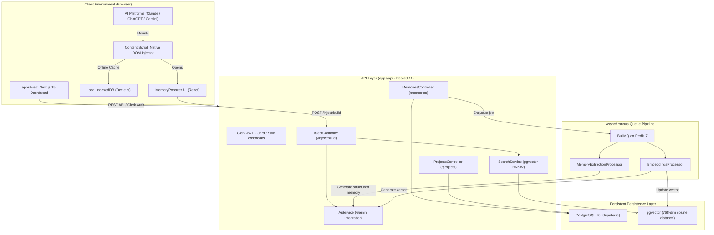
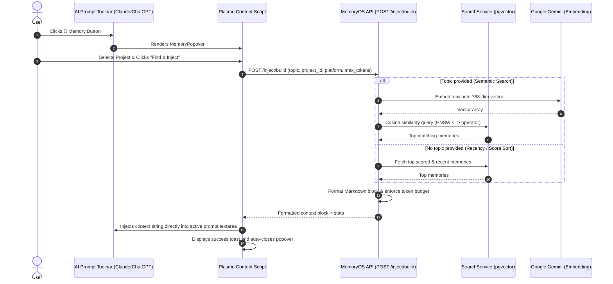

# System Architecture & Technical Design

MemoryOS is architected as a high-performance, modular TypeScript monorepo managed via **Turborepo** and **pnpm workspaces**. It decouples browser-native context injection, background asynchronous AI pipelines, and user dashboard management.

---

## 1. Monorepo Structure

```
MemoryOS/
├── apps/
│   ├── api/             # NestJS 11 backend REST API & background processors
│   ├── web/             # Next.js 15 App Router web dashboard
│   └── extension/       # Plasmo MV3 Chrome extension & platform injectors
├── packages/
│   ├── config/          # Shared ESLint, Prettier, Tailwind, and TSConfigs
│   ├── queue/           # BullMQ queue name tokens and type definitions
│   ├── types/           # Core shared TypeScript domain interfaces
│   ├── ui/              # Shared React UI components (Radix / Tailwind)
│   └── utils/           # Shared helper functions and formatting utilities
├── prisma/
│   ├── schema.prisma    # Canonical database schema & pgvector configurations
│   ├── migrations/      # Version-controlled SQL migration scripts
│   └── seed.ts          # Seed data script for local testing
├── context/             # Foundational product & architecture specifications
├── docs/                # Comprehensive technical documentation & guides
├── scripts/             # Local developer tooling (Redis dev runner, DB verification)
├── turbo.json           # Turborepo task pipeline configuration
└── pnpm-workspace.yaml  # Workspace directory declarations
```

---

## 2. High-Level Component Topology



---

## 3. Core Operational Lifecycles

### Lifecycle A: Memory Extraction & Processing Pipeline

1. **Ingestion**: Conversations captured from supported AI platforms are posted to `/conversations`.
2. **Queueing**: The API pushes an extraction task to the `memory-extraction` BullMQ queue.
3. **AI Structured Extraction**: The `MemoryExtractionProcessor` invokes Google Gemini using an extraction prompt that parses dialogue into standardized structured objects (`personal`, `preference`, `tool`, `project`, `workflow`, `decision`, `template`, `entity`).
4. **Suggestion Generation**: Memories are saved in state `pending_review` (or auto-approved for verified workflows).
5. **Vector Embedding**: Upon memory approval, an embedding job is enqueued in the `embeddings` queue. The `EmbeddingsProcessor` generates a 768-dimensional vector via Gemini (`gemini-embedding-2` / `embedding-001`) and writes it to the `embedding` column on the `memories` table in PostgreSQL.

### Lifecycle B: Context Retrieval & Prompt Injection



---

## 4. Architectural Guarantees & Constraints

1. **Strict User Scoping (Tenant Isolation)**:
   - Every database query executed by `PrismaService` is strictly constrained by `WHERE user_id = currentUserId`.
   - Raw SQL pgvector queries explicitly require and cast the `user_id` as UUID (`WHERE user_id = $1::uuid`).
2. **Controller/Service Separation**:
   - NestJS controllers handle request routing, DTO validation, and response serialization.
   - All business logic, Prisma queries, and external API calls reside exclusively in injectable services.
3. **Decoupled Asynchronous Processing**:
   - Time-consuming LLM extraction and vector generation are offloaded to BullMQ workers. API endpoints return immediately with acknowledgement responses.
4. **Zero Page Push in Browser Extension**:
   - The Chrome extension mounts unobtrusively into native toolbars rather than creating fixed sidebars that disrupt Claude or ChatGPT responsive layout containers.
5. **Fallback Rotation for AI Services**:
   - The API supports comma-separated fallback API keys for Google Gemini to prevent disruption during quota throttling.
