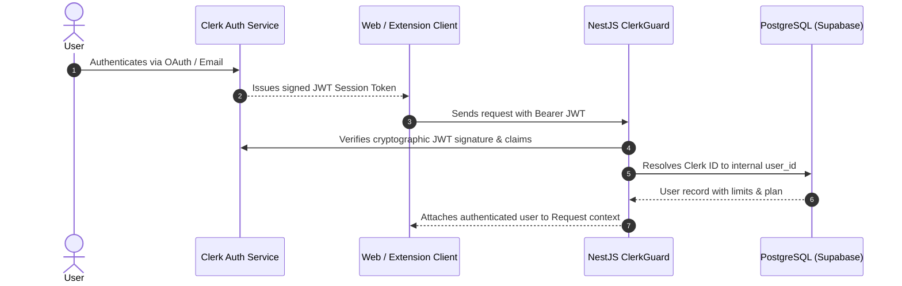

# Security Architecture & Data Privacy

MemoryOS is designed around strict data ownership, user privacy, and zero cross-tenant knowledge leakage. Users must feel entirely confident that their proprietary code, business logic, personal preferences, and AI discussions remain isolated and protected.

---

## 1. Zero Cross-Tenant Leakage Principles

### 1.1 Strict Service-Layer User Scoping
In MemoryOS, database-level isolation is enforced at the service layer on every query:

1. **Every Prisma Query Scoped**: Every call to `prisma.memory.findMany()`, `prisma.project.findFirst()`, `prisma.conversation.delete()`, etc. explicitly requires `WHERE user_id = currentUserId`.
2. **Raw Vector Query Casting**: In `SearchService`, raw SQL queries to pgvector strictly bind `$2::uuid` to the validated caller's `user_id`. It is architecturally impossible for a vector search to return another user's memories, even if cosine distance is 0.0 (identical text).

```typescript
// Enforced user isolation in SearchService
const query = await this.prisma.$queryRawUnsafe(`
  SELECT m.id, m.content, 
    1 - (m.embedding <=> $1::vector) AS similarity
  FROM memories m
  WHERE m.user_id = $2::uuid AND (m.project_id = $3::uuid OR m.project_id IS NULL)
  ORDER BY similarity DESC
  LIMIT $4;
`, `[${embedding.join(',')}]`, userId, projectId, limit);
```

### 1.2 Cascading Hard Deletion
When a user deletes a project or account:
- Foreign keys specify `ON DELETE CASCADE`.
- Vector embeddings and cached search tokens are deleted synchronously with the row. No orphaned vector data remains in pgvector.

---

## 2. Authentication & Authorization



### 2.1 JWT Verification via `ClerkGuard`
- Stateless verification using Clerk's backend SDK (`@clerk/backend`).
- Validates token expiration, signature against Clerk's public keys, and audience claims before route execution.

### 2.2 Webhook Signature Verification (`Svix`)
- The Clerk user synchronization endpoint (`POST /auth/webhook`) requires Svix signature verification.
- Incoming payloads without valid `svix-id`, `svix-timestamp`, and `svix-signature` headers matching `CLERK_WEBHOOK_SECRET` are rejected immediately with `400 Bad Request`.

---

## 3. Chrome Extension Security Model

### 3.1 Content Script Isolation
The Chrome extension operates in isolated execution worlds under Chrome Manifest V3:
- Content scripts cannot access the host page's JavaScript global window objects directly.
- The **`MemoryPopover`** uses pure inline CSS properties rather than injecting global class stylesheets into Claude or ChatGPT, preventing visual collisions or DOM tampering.

### 3.2 Token Storage & Least Privilege
- The Clerk session token is stored in `chrome.storage.local` (accessible only to the extension bundle, never exposed to webpage scripts).
- Permissions declared in `manifest.json` are strictly restricted to supported AI hosts (`chatgpt.com`, `claude.ai`).

---

## 4. Secret Management & Hygiene

- **No Secrets in Source Control**: All sensitive values (`DATABASE_URL`, `GEMINI_API_KEYS`, `CLERK_SECRET_KEY`, `STRIPE_SECRET_KEY`) reside exclusively in `.env` and are strictly ignored via `.gitignore`.
- **API Key Pool Safety**: Gemini API keys are consumed server-side only in `apps/api`. Keys are never sent down to the browser extension or client web app.
